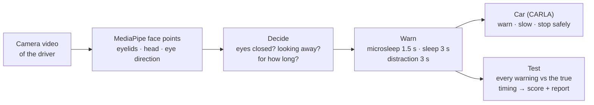
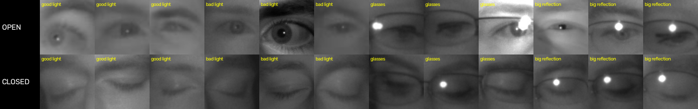
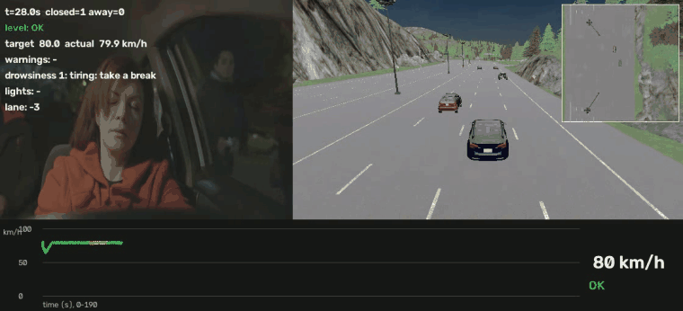

# driver-attention-bench

**New cars in Europe must watch the driver.** A dashboard camera checks whether the eyes are closed or off the road,
and Euro NCAP tests it with fixed rules: eyes closed 3 s = "sleep", and the warning must come within 0.2 s of that moment.

This project builds such a driver monitor from open tools, **tests it the way a car maker's validation team would**, and connects
it to a car in the CARLA simulator to see what the warning is worth on the road.

<p align="center">
  
</p>
<p align="center"><sub>Live phone camera. Green/red: the system's decision per frame. Yellow: truth, labelled by hand without seeing
the output. 4 of 4 warnings within ±0.2 s, 0 false alerts. One take, and a look-down fix was tuned on it: a demo, not a statistic.
<a href="https://raw.githubusercontent.com/HarishDeepak/driver-attention-bench/main/results/videos/live_phone_take5.mp4">Full take (MP4)</a></sub></p>

## How it works



Details: [architecture](docs/ARCHITECTURE.md) · [how warnings are scored](docs/METHOD.md) · [every experiment](docs/EXPERIMENTS.md).

**Terms.** *Microsleep / sleep*: eyes closed 1.5 s / 3 s. *SD-202*: Euro NCAP's driver-state test protocol. *EAR*: eye aspect
ratio, eyelid opening from face points. *PERCLOS*: share of time the eyes are closed. *KSS*: 1-9 sleepiness self-rating.
*MRM*: minimal-risk manoeuvre, the car stopping itself safely. *False alerts/h*: warnings with no real event, per hour of video.

## What's inside

**Data: six sources, each answering a different question**

| Data | What it is | Why it is here | Used in |
|---|---|---|---|
| Synthetic drivers (Blender + MPFB2) | 6 rendered clips, exact labels, sunglasses / mask | check the pipeline where the truth is perfect | step 1 |
| DMD (Vicomtech) | 13 videos of 6 real drivers, frame labels | real faces, acted closures and glances | steps 2, 3, 6 |
| Own phone takes | voice-guided live recordings, labelled by hand | live camera, end to end | top demo, step 5 |
| NITYMED | 19 night drives in real cars | darkness, real microsleeps | steps 4, 6 |
| MRL Eye | infrared eye crops, 37 people (17k of 85k sampled) | infrared, as in car cameras | step 3 |
| UTA-RLDD | 18 × 10 min, 6 people alert / low vigilant / drowsy | natural, not acted, drowsiness | step 6 |

**Methods: from cheap and fast to heavy and slow**

| Method | What it is | Runs at | Verdict |
|---|---|---|---|
| Blink score, EAR | eyelid opening from MediaPipe face points | 35-58 fps, CPU | used for all warnings |
| Head pose + eye direction, MobileGaze | where the driver looks | 12-58 fps | head pose default; MobileGaze too slow |
| DINOv2, CLIP + linear probe | foundation-model features of the eye | ~4 ms, GPU | as good as EAR, not better |
| Llama 3.2 Vision, Nemotron VL | chat-style vision models asked "eyes closed?" | 3-9 s per frame | near guessing; offline only |
| SD-202 timers + drowsiness level | turn per-frame states into warnings and a level | instant | the decision layer |
| CARLA escalation, Monte Carlo | what the car does, and what it is worth | simulator | the payoff |

## The story in six steps

**1. Build it and check it where the truth is exact.** Computer-generated drivers (Blender) have perfect labels: 15 of 18
warnings on time, 0 false alerts. The 3 misses are eyes behind dark sunglasses, reported as "unknown" on purpose. These clips
were also used to fix bugs, so this is a regression check, not a validation.

**2. Real drivers: many failures were in the test, not the detector, and it is still far from production.** On the DMD dataset
the first run caught 7 of 66 events in time. Scoring only where labels exist and a longer calibration gave 10 of 58; counting
"closed" only when the lids are actually shut (SD-202 times eye closure) gave 22 of 49 (95 % CI 0.32-0.59) with the same
detector, 31 of 49 with EAR. The cost: 19 (default) to 41 (EAR) false alerts per hour, and 27 of 49 events with the default
detector are still missed or off by more than 0.2 s.

<p align="center"></p>

**3. Big AI models did not beat simple signals.** Foundation models (DINOv2, CLIP) recognise closed eyes as well as a simple
eyelid measurement (≈ 97 % per frame) but not better; chat-style vision models were near guessing and took seconds per frame.
Infrared matters: on infrared eye crops (not a whole-face cabin camera), a model trained on daylight drops to 0.69-0.76,
0.93-0.94 when trained on infrared; glasses and reflections are the hard cases.

<p align="center"></p>
<p align="center"><sub>Infrared eyes, open (top) and closed (bottom), by condition. MRL Eye dataset (Fusek 2018), shown with citation.</sub></p>

**4. Night drivers exposed a calibration flaw.** On real night-time videos (NITYMED) the system often said "open" while the eyes
were shut: the driver's "normal" face was learned during a blink. A robust calibration raised hand-labelled hits from 7 to 10
of 27 with no change on any other dataset; switching to EAR reached 16 of 27, but adds false alerts on DMD and the phone take.

<p align="center"></p>
<p align="center"><sub>Night driving, real car (NITYMED, CC BY 4.0, Petrellis et al.); yellow = hand-labelled truth.
<a href="https://raw.githubusercontent.com/HarishDeepak/driver-attention-bench/main/results/videos/night_nitymed_P1042793.mp4">Full video (MP4)</a></sub></p>

**5. What is a warning worth on the road?** In CARLA, a driver who stays asleep gets warning → slow-down → a minimal-risk
manoeuvre (hazards, move right if the lane is free, stop at its edge; profile borrowed from UN R157, which itself covers automated
lane keeping). For an inattentive driver, warning earlier because the camera saw it avoids crashes at 30-50 km/h. Plugging the
accuracy measured on real drivers into a Monte Carlo, at 50 km/h the crash rate falls from 87 % (no camera) to 70 % with the
measured gaze detector (it catches 3 of 12 glances), 44 % with the measured eye-closure detector and 17 % with a perfect one.

<p align="center">
  
  
</p>
<p align="center"><sub>Sleeping driver: warning 3.5 s, slowing 10 s, manoeuvre 15 s, standstill 23 s.
<a href="https://raw.githubusercontent.com/HarishDeepak/driver-attention-bench/main/results/videos/carla_minimal_risk_manoeuvre.mp4">Full run (MP4)</a> ·
<a href="https://raw.githubusercontent.com/HarishDeepak/driver-attention-bench/main/results/videos/face_to_carla_take5.mp4">my recorded face driving the car (MP4)</a></sub></p>

**6. Drowsy is not asleep.** Euro NCAP wants a drowsy driver warned and the collision warning made earlier; only an
*unresponsive* driver gets an automatic stop. So a drowsiness level (0-3) now counts microsleeps over 5 minutes, long blinks and
the share of time the eyes are closed; level 3 caps the speed at 60 km/h (my assumption). Two findings: looking down lowers
the eyelids and was being counted as drowsiness (fixed: false levels on alert DMD drivers 4/6 → 1/6); and on real-life video of
6 people (UTA-RLDD) the level fired on 0 of 6 alert videos, but caught only 2 of 6 self-rated drowsy ones, one of them doubtful:
it detects repeated microsleeps, not early, quiet drowsiness.

<p align="center"></p>
<p align="center"><sub>A night driver's video drives the CARLA car: repeated microsleeps → level 3 at 37 s → 60 km/h.
<a href="https://raw.githubusercontent.com/HarishDeepak/driver-attention-bench/main/results/videos/drowsy_night_driver_to_carla.mp4">Full run (MP4)</a></sub></p>

## What I would do next

- Earlier drowsiness cues (blink rate and speed) tuned on a dataset with drowsiness rated over time (UL-DD, DROZY).
- A real infrared camera and more people; the eye "unknown" check needs real glasses and dim light, not only synthetic ones.
- A lead car in the CARLA scene so the earlier collision warning for a drowsy driver is shown in the loop, not only in the sweep.

## Run

Without any dataset you can run the self-checks, a live webcam, and the CARLA demo with a simulated driver. The dataset results
need DMD / NITYMED / UTA-RLDD / MRL Eye, downloaded from their owners (see Data and licence).

```bash
pip install -r requirements.txt            # Python 3.12 (carla / torch only needed for the simulator / foundation-model parts)
mkdir -p models && curl -L -o models/face_landmarker.task https://storage.googleapis.com/mediapipe-models/face_landmarker/face_landmarker/float16/1/face_landmarker.task
python src/dms_core.py && python src/signals.py && python src/drowsiness.py && python src/escalation.py   # self-checks (also in CI)

python scripts/run_clip.py <video.mp4 | camera-index> --show [--eye ear]           # one video or camera, live overlay
bash run_suite.sh scenarios/synthetic.toml                                        # suite → scores → PDF report (Linux / WSL)
python scripts/live_demo.py sim:2-40 --headless --video out.mp4                   # CARLA 0.9.16 running; or a face video
bash scripts/ros2/record.sh                                                       # ROS 2 Jazzy: /dms/state + rosbag
```

Optional models: `yunet.onnx` (opencv_zoo `face_detection_yunet_2023mar.onnx`) and `mobileone_s0_gaze.onnx` (MobileGaze, MIT).
CARLA: set `CARLA_ROOT` if it is not in `C:\carla\CARLA_0.9.16`; `run_suite.sh` takes the Python path from `PY`.
Optional parts (ROS 2, Blender, Cosmos): [`docs/details/`](docs/details/).

## Data and licence

Code: MIT ([`LICENSE`](LICENSE)). Data keeps its own terms and is never redistributed here except NITYMED clips (CC BY 4.0,
Petrellis et al.): DMD (Vicomtech, CC BY-NC-ND 4.0; request it, then `python scripts/dmd_to_labels.py`), UTA-RLDD (Ghoddoosian
et al. 2019; numbers only), MRL Eye (numbers only).

## Limits

Small datasets (DMD 6 drivers, 2 hand-labelled night videos, 6 real-life drowsiness subjects, a few own phone takes); thresholds,
reaction times and braking values are stated assumptions, not product values; CARLA has no in-cabin camera, so the face comes
from video; simplified car physics. Personal project by Harish Deepak (TU Darmstadt), October 2026. No product claims.
