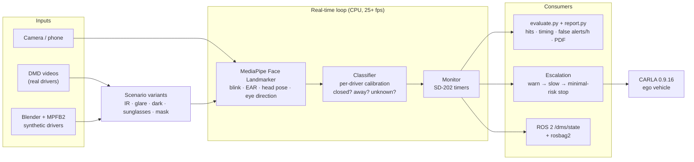
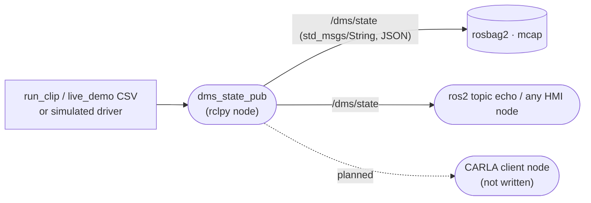
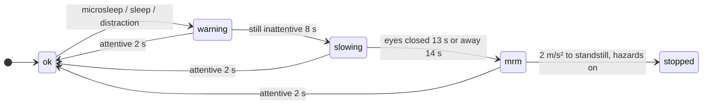

# driver-attention-bench

A test bench for camera-based **driver monitoring (DMS)**. It checks whether a real-time pipeline warns on time under the
**Euro NCAP SD-202** test procedure, measures where it fails on real and synthetic drivers, and closes the loop in **CARLA**:
the driver state slows the car and brings it to a minimal-risk stop.

Personal project. Small datasets, simplified vehicle models, no product claims.

<p align="center">
  
  &nbsp;
  
</p>
<p align="center"><sub>Left: synthetic driver, per-frame decision and SD-202 warnings. Right: same state driving the CARLA ego car
(warning 3.5 s, slowing 10 s, minimal-risk stop 15 s, standstill 22.5 s; the first 2 s are the Traffic Manager settling).</sub></p>

## Results

| Question | Answer | Details |
|---|---|---|
| Does it warn on time on exactly labelled synthetic drivers? | 15/18 within ±0.2 s, 0 false alerts. The 3 misses are eyes behind dark sunglasses, reported as *unknown* on purpose | [E1](docs/EXPERIMENTS.md#e1-synthetic-drivers-blender-6-clips-exact-labels) |
| On real drivers (DMD, 6 people)? | First run 7/66. Fixing the **measurement** (scoring scope, 20 s calibration, label definition) gave 22/49 (blink score) and 30/49 (EAR) | [E2, E3](docs/EXPERIMENTS.md#e2-real-drivers-dmd-from-first-run-to-the-fixed-measurement) |
| Do foundation models see closed eyes better? | No. DINOv2 / CLIP linear probes ≈ 0.97 balanced accuracy per frame, same as the cheap signals; zero-shot CLIP 0.70 | [E4](docs/EXPERIMENTS.md#e4-foundation-models-for-eye-state-dmd-per-frame-leave-one-subject-out) |
| Can a hosted VLM do the job? | No. Llama 3.2 Vision / Nemotron VL ≈ 0.59 on eye state at 3-9 s per frame: offline use only | [E5](docs/EXPERIMENTS.md#e5-hosted-vision-language-models-vlms-on-synthetic-frames) |
| Does driver state matter for the car? | Inattentive driver + standard collision warning crashes at 30 and 50 km/h; warning earlier when the DMS reports inattention stops in time | [E6](docs/EXPERIMENTS.md#e6-carla-why-driver-state-matters-for-the-car) |

<p align="center">
  
  
</p>

## Architecture



Methods are organised in tiers, the way production DMS work splits them; every tier is scored with the same evaluator:

| Tier | Runs where | Methods | Role here |
|---|---|---|---|
| 1. Real time | CPU, 25+ fps | MediaPipe blink score / EAR, head pose, MobileGaze CNN | warnings, escalation, CARLA |
| 2. Stronger perception | GPU, ~4 ms/frame | DINOv2 / CLIP features + linear probe | does a foundation backbone help? |
| 3. Offline / cloud | seconds per frame | hosted VLMs (Llama 3.2 Vision, Nemotron VL) | auto-labelling, event review |
| 4. Data generation | offline | Blender drivers, image variants, CARLA, Cosmos control videos | test cases you cannot record safely |

### ROS 2 interface



Message: `{"t", "closed", "away", "warnings", "level"}` at the frame rate. Runs on ROS 2 Jazzy in WSL Ubuntu 24.04.
CARLA's native ROS 2 is not used: it is a no-op in the Windows build and Jazzy has a FastDDS mismatch ([details](docs/details/ROS2.md)).

### Escalation state machine



## How it is measured

- **Rules:** microsleep 1.5 s, sleep 3 s, long distraction 3 s; a warning is on time within **±0.2 s** (SD-202 v1.2).
- **Outcomes:** hit / early / late / miss per labelled event, false alerts per scored hour, **Wilson 95 %** intervals for small counts.
- **No tuning on test data:** knobs are chosen **leave-one-subject-out** (`scripts/replay.py --loso`).
- **Scope:** a kind is only scored where the dataset labels it; events during calibration are excluded.

Full method: [`docs/METHOD.md`](docs/METHOD.md) · all experiments, including what did not work: [`docs/EXPERIMENTS.md`](docs/EXPERIMENTS.md).

## Repository layout

```
driver-attention-bench/
├── src/                    core library (pure Python, each file has an assert self-check)
│   ├── signals.py          MediaPipe signals, calibration, per-frame decision, comparison arms
│   ├── dms_core.py         SD-202 timers (Monitor)
│   ├── escalation.py       warn → slow → minimal-risk stop
│   ├── variants.py         IR look, glare, dark, sunglasses, mask
│   ├── evaluate.py         event matching, Wilson CI, false alerts/h, arm comparison
│   └── report.py           PDF test report
├── scripts/                entry points
│   ├── run_clip.py         one video / camera → per-frame CSV + warnings
│   ├── replay.py           re-run the decision step on saved signals (threshold sweeps, LOSO)
│   ├── dmd_to_labels.py    DMD OpenLABEL → events + scoring scope
│   ├── carla_fcw.py        collision-warning sweep      live_demo.py   escalation in CARLA
│   ├── ros2/               dms_state_pub.py (rclpy), record.sh (rosbag2)
│   ├── fm_eye_probe.py     DINOv2 / CLIP probes          vlm_arm.py     hosted VLM test
│   ├── cosmos_transfer.py  Cosmos Transfer request (prepared, endpoint unavailable on free tier)
│   └── make_results.py     builds results/ from out/
├── scenarios/*.toml        test suites: clips × variants × settings
├── tools/blender/          synthetic driver renders (Blender 4.5 + MPFB2)
├── results/                published figures, summary CSVs, synthetic PDF report
├── docs/                   METHOD.md, EXPERIMENTS.md, details/ (setup, theory, ROS 2, synthetic, Cosmos)
└── run_suite.sh            suite runner (Linux / WSL)
```

## Run

```bash
# self-checks
python src/dms_core.py && python src/signals.py && python src/evaluate.py && python scripts/replay.py

# one video or camera with live overlay
python scripts/run_clip.py <video.mp4 | camera-index> --show

# a scenario suite (Linux / WSL): clips × variants → scoring → out/<name>/report.pdf
bash run_suite.sh scenarios/synthetic.toml          # or scenarios/dmd.toml

# CARLA 0.9.16 (start CarlaUE4.exe -quality-level=Low first)
python scripts/carla_fcw.py                         # collision-warning sweep
python scripts/live_demo.py sim:2-40 --headless     # escalation with a simulated driver (or a camera index)

# ROS 2 (Jazzy): publish + record + replay the driver state
bash scripts/ros2/record.sh
```

**Setup.** Python 3.12: `mediapipe opencv-python onnxruntime carla matplotlib` (+ `torch transformers scikit-learn` for the
foundation-model probe). Models go in `models/`, not in git:
- `face_landmarker.task`: https://storage.googleapis.com/mediapipe-models/face_landmarker/face_landmarker/float16/1/face_landmarker.task
- `yunet.onnx` (optional face fallback): `face_detection_yunet_2023mar.onnx` from opencv_zoo
- `mobileone_s0_gaze.onnx` (optional `--gaze mobilegaze` arm): MobileGaze MobileOne-S0 export, MIT licence

DMD is not redistributed (CC BY-NC-ND): request it from Vicomtech, then `python scripts/dmd_to_labels.py`.
Optional parts (ROS 2, Blender, Cosmos): [`docs/details/`](docs/details/).

## Limitations

- DMD: 6 drivers, RGB face camera, one car. Synthetic: 3 rendered identities with simple eyelids. No own IR recordings.
- Thresholds, reaction times and braking values are stated assumptions, not values from any product.
- CARLA has no in-cabin camera: the face comes from video, the vehicle from the simulator.
- Per-frame foundation-model results exclude half-open frames, so they are easier than the event-level task.
