# driver-attention-bench

**New cars in Europe must watch the driver.** A small camera on the dashboard checks whether the driver's eyes are closed or
looking away from the road, and the car must warn in time. Euro NCAP, the European crash-test rating, tests this with fixed rules:
eyes closed for 3 seconds = "sleep", and the warning has to come within 0.2 seconds of that moment.

This project builds such a driver monitor from open tools and then **tests it the way a car maker's validation team would**:
on real drivers, on computer-generated drivers, against the official timing rules, and in a driving simulator where a sleeping
driver makes the car slow down and stop.

<p align="center">
  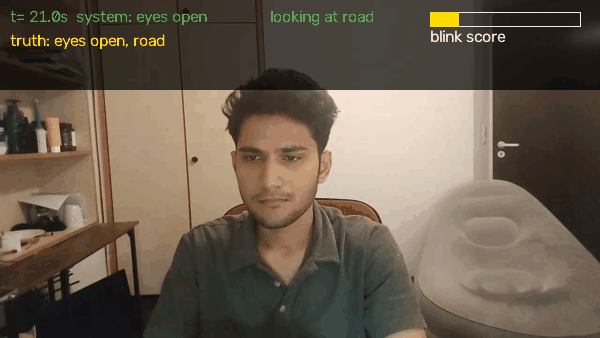
</p>
<p align="center"><sub>Live test, phone camera at ~30 fps, voice-guided: eyes closed → microsleep (1.5 s) and sleep (3 s); looking down and
turning the head → distraction (3 s). Green/red: the system's per-frame decision. Yellow: truth, labelled by hand frame by frame
without looking at the system's output. Result: 4 of 4 warnings within ±0.2 s, 0 false alerts (one take: a demo, not a statistic).</sub></p>
<p align="center"><a href="results/videos/live_phone_take5.mp4?raw=true">⬇ full take, 57 s (MP4 download)</a> · GIF above is a short excerpt</p>

<p align="center">
  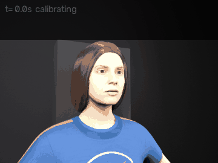
</p>
<p align="center"><sub>Same pipeline on a computer-generated driver (Blender), where every label is exact.</sub></p>
<p align="center"><a href="results/videos/synthetic_sleep.mp4?raw=true">⬇ full clip, 20 s (MP4 download)</a></p>

## How it works, in 4 steps

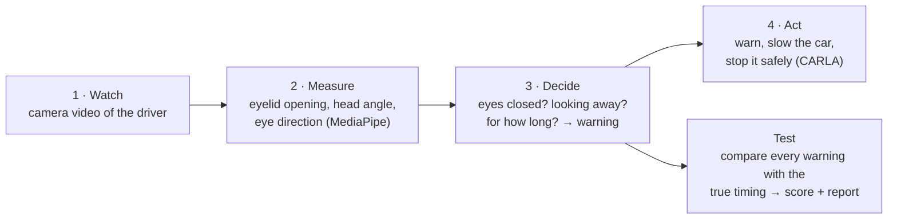

1. **Watch.** Video of a driver: real drivers from the DMD research dataset, rendered drivers from Blender, or a live camera.
2. **Measure.** Google's MediaPipe finds 478 points on the face and reports how open the eyes are and where the head points.
3. **Decide.** The system first learns this driver's normal face (calibration), then flags *eyes closed* or *looking away*.
   Timers turn that into the three official warnings: microsleep (1.5 s), sleep (3 s), distraction (3 s).
4. **Act.** In the CARLA driving simulator, a driver who stays asleep triggers warning → slow down → a minimal-risk manoeuvre: hazard lights, move to the rightmost lane if it is free, stop at its edge.

<p align="center">
  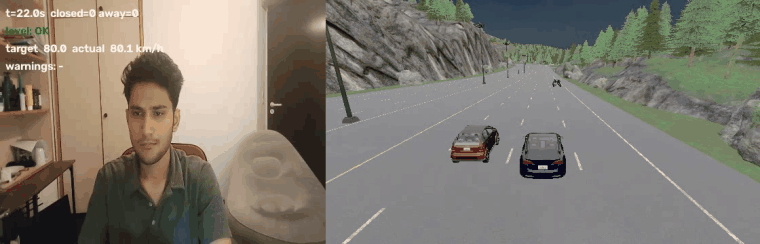
</p>
<p align="center"><sub>Closed loop with real data: the recorded phone take (left, live detection) drives the CARLA ego car (right).
Eyes close → sleep warning → DMS level WARNING in the car. The driver looks back within 8 s, so it never escalates further.</sub></p>
<p align="center"><a href="results/videos/face_to_carla_take5.mp4?raw=true">⬇ full run, 56 s (MP4 download)</a> · GIF above is a short excerpt</p>

<p align="center">
  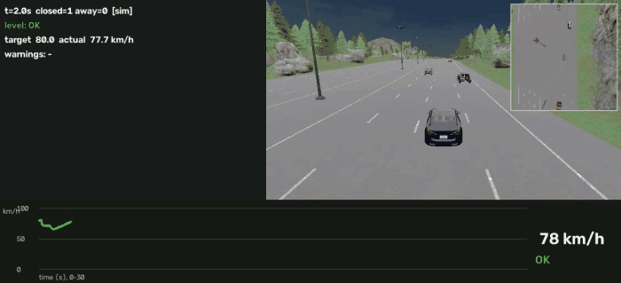
  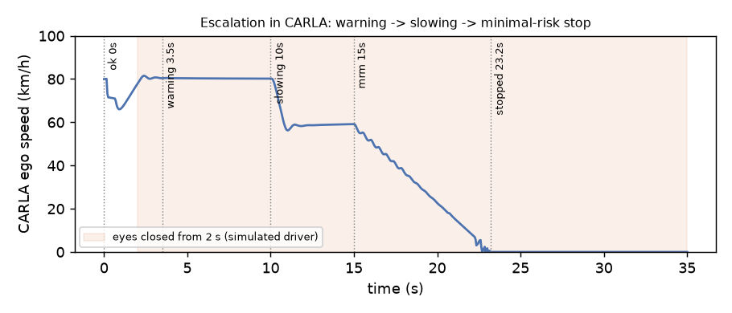
</p>
<p align="center"><sub>If the driver stays asleep (simulated driver, eyes closed from 2 s): warning 3.5 s, slowing to 60 km/h from 10 s (8 s after the eyes closed),
minimal-risk manoeuvre from 15 s (hazards on, CARLA's planner checks the right lane is free, moves one lane right, brakes at
2 m/s² to the lane's right edge), standstill at 23.2 s.</sub></p>
<p align="center"><a href="results/videos/carla_minimal_risk_manoeuvre.mp4?raw=true">⬇ full run, 35 s (MP4 download)</a> · GIF above is a short excerpt</p>

## What I found

1. **Most of the early "failures" were test-setup mistakes, not detector mistakes.** On real drivers the first run caught only
   7 of 66 events in time. Scoring only where the dataset has labels, calibrating over 20 s instead of 2 s, and defining
   "closed" as lids actually shut raised that to 22 of 49 with the same blink-score detector (30 of 49 with the EAR signal).
2. **Big AI models did not beat the simple signals.** DINOv2 and CLIP (foundation models) recognised closed eyes about as well as
   the simple eyelid measurement (≈ 97 % per frame). Large chat-style vision models (VLMs) were close to guessing and took
   3-9 seconds per frame. For a warning that must come within 0.2 s, the small fast model is the right tool.
   On **real infrared** eye images (night-time cameras), an eye model trained on daylight video dropped to 0.69-0.76; trained on
   infrared it reached 0.93-0.94 on unseen people. Day-to-night is a real gap, which is why car DMS cameras are infrared.
   On **night-time videos of real drivers** the eyes were often reported open while shut: a fragile calibration step learned the
   wrong "normal" when a driver blinked during it. A robust calibration plus the EAR signal raised hand-labelled night hits from
   7 to 16 of 27 without hurting any other dataset.

<p align="center">
  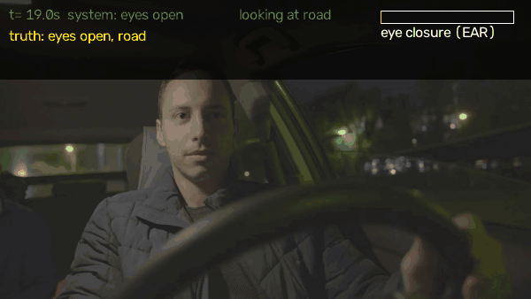
</p>
<p align="center"><sub>Night driving, real car (NITYMED, CC BY 4.0, Petrellis et al.): EAR with robust calibration; yellow = hand-labelled truth.</sub></p>
<p align="center"><a href="results/videos/night_nitymed_P1042793.mp4?raw=true">⬇ full video, 2 min (MP4 download)</a> · <a href="results/videos/night_driver_to_carla.mp4?raw=true">⬇ same driver driving the CARLA car (MP4)</a>: a warning at each microsleep cluster; no slow-down, because he always reopened his eyes within 8 s (escalation needs continuous inattention)</p>
3. **Driver state changes the crash outcome, and detector accuracy decides by how much.** In CARLA, a distracted driver with a
   standard collision warning crashes at 30 and 50 km/h; warning earlier because the camera flags the distraction avoids both.
   A Monte Carlo over driver reaction times then plugs in the accuracy measured on real drivers: at 50 km/h the crash rate falls
   from 87 % (no DMS) to 44 % (measured DMS: EAR, lids-shut labels, 61 % caught) and 17 % (ideal DMS). Reaction times are an assumption; the chain is the point.

<p align="center">
  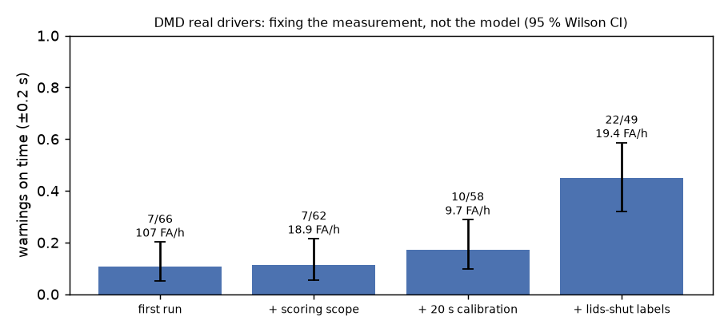
  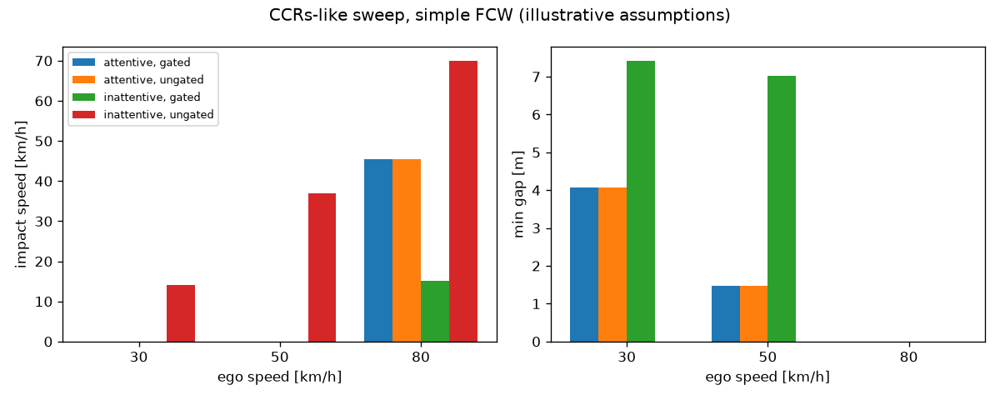
</p>
<p align="center">
  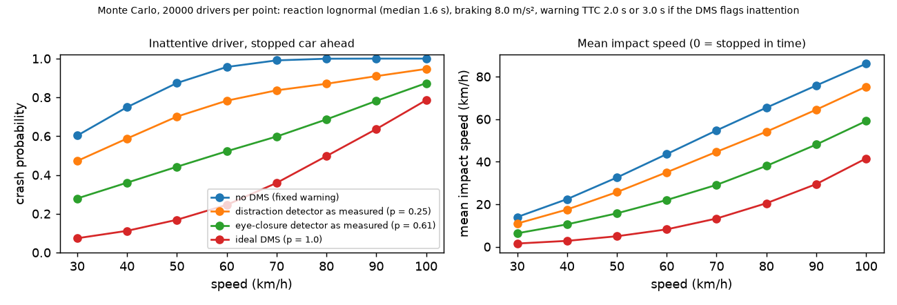
</p>

Personal project by Harish Deepak (TU Darmstadt), October 2026: small datasets, simplified car physics, no product claims.

Every number, including what did not work: [`docs/EXPERIMENTS.md`](docs/EXPERIMENTS.md). How each warning is scored: [`docs/METHOD.md`](docs/METHOD.md).

## Under the hood

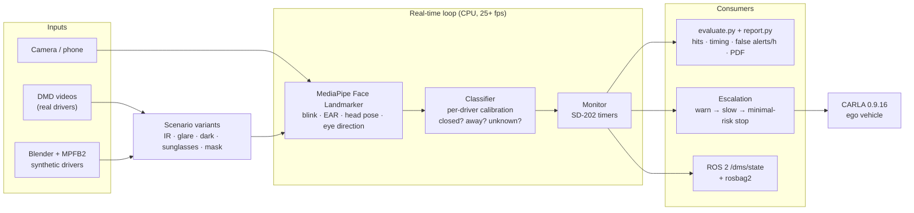

Methods are organised in tiers, the way production DMS work splits them; every tier is scored with the same evaluator:

| Tier | Runs where | Methods | Role here |
|---|---|---|---|
| 1. Real time | CPU, 25+ fps | MediaPipe blink score / EAR, head pose (MobileGaze CNN: 12-17 fps, below 25) | warnings, escalation, CARLA |
| 2. Stronger perception | GPU, ~4 ms/frame | DINOv2 / CLIP features + linear probe | does a foundation backbone help? |
| 3. Offline / cloud | seconds per frame | hosted VLMs (Llama 3.2 Vision, Nemotron VL) | auto-labelling, event review |
| 4. Data generation | offline | Blender drivers, image variants, CARLA, Cosmos control videos | test cases you cannot record safely |

### ROS 2 interface


Message: `{"t", "closed", "away", "warnings", "level"}` at the frame rate. Runs on ROS 2 Jazzy in WSL Ubuntu 24.04.
CARLA's native ROS 2 is not used: it is a no-op in the Windows build and Jazzy has a FastDDS mismatch ([details](docs/details/ROS2.md)).

### Escalation state machine

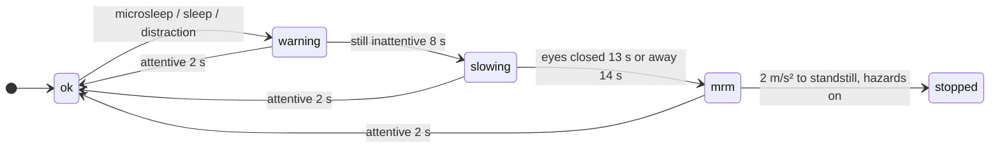

## Repository layout

```
driver-attention-bench/
├── src/                    core library (pure Python, each file has an assert self-check)
│   ├── signals.py          MediaPipe signals, calibration, per-frame decision, comparison arms
│   ├── dms_core.py         SD-202 timers (Monitor)
│   ├── escalation.py       warn → slow → minimal-risk manoeuvre (2 m/s² ramp)
│   ├── dino_eye.py         DINOv2 + linear probe eye-state arm (live, GPU)
│   ├── variants.py         IR look, glare, dark, sunglasses, mask
│   ├── evaluate.py         event matching, Wilson CI, false alerts/h, arm comparison
│   └── report.py           PDF test report
├── scripts/                entry points
│   ├── run_clip.py         one video / camera → per-frame CSV + warnings
│   ├── replay.py           re-run the decision step on saved signals (threshold sweeps, LOSO)
│   ├── render_overlay.py   burn decisions, truth and warnings into a video
│   ├── cues_to_labels.py   voice-cue log → labels (no detections used)
│   ├── dmd_to_labels.py    DMD OpenLABEL → events + scoring scope
│   ├── carla_fcw.py        collision-warning sweep
│   ├── dms_safety_mc.py    DMS accuracy → crash-probability Monte Carlo
│   ├── live_demo.py        DMS → escalation → CARLA (traffic, minimal-risk manoeuvre via CARLA BasicAgent, --video)
│   ├── ros2/               dms_state_pub.py (rclpy), record.sh (rosbag2)
│   ├── fm_eye_probe.py     DINOv2 / CLIP probes (DMD)
│   ├── ir_eye_probe.py     infrared eye images (MRL Eye)
│   ├── vlm_arm.py          hosted vision-language models
│   ├── cosmos_transfer.py  Cosmos Transfer request (prepared, endpoint unavailable on free tier)
│   └── make_results.py     builds results/ from out/
├── scenarios/*.toml        test suites: clips × variants × settings
├── tools/blender/          synthetic driver renders (Blender 4.5 + MPFB2)
├── results/                published figures, summary CSVs, synthetic PDF report
├── docs/                   METHOD.md, EXPERIMENTS.md, details/ (setup, theory, ROS 2, synthetic, Cosmos)
└── run_suite.sh            suite runner (Linux / WSL)
```

## Run

```bash
# self-checks
python src/dms_core.py && python src/signals.py && python src/evaluate.py && python scripts/replay.py

# one video or camera with live overlay
python scripts/run_clip.py <video.mp4 | camera-index> --show [--eye ear|dino] [--record take.mp4]

# a scenario suite (Linux / WSL): clips × variants → scoring → out/<name>/report.pdf
bash run_suite.sh scenarios/synthetic.toml          # or scenarios/dmd.toml

# CARLA 0.9.16 (start CarlaUE4.exe -quality-level=Low first)
python scripts/carla_fcw.py                         # collision-warning sweep
python scripts/live_demo.py sim:2-40 --headless --video out.mp4   # simulated driver (or a camera index / face video)

# ROS 2 (Jazzy): publish + record + replay the driver state
bash scripts/ros2/record.sh
```

**Setup.** Python 3.12: `pip install -r requirements.txt` (`mediapipe opencv-python onnxruntime carla matplotlib` (+ `torch transformers scikit-learn` for the
foundation-model arms, `shapely networkx` for CARLA's navigation agents used in the minimal-risk manoeuvre)). Models go in `models/`, not in git:
- `face_landmarker.task`: https://storage.googleapis.com/mediapipe-models/face_landmarker/face_landmarker/float16/1/face_landmarker.task
- `yunet.onnx` (optional face fallback): `face_detection_yunet_2023mar.onnx` from opencv_zoo
- `mobileone_s0_gaze.onnx` (optional `--gaze mobilegaze` arm): MobileGaze MobileOne-S0 export, MIT licence

DMD is not redistributed (CC BY-NC-ND): request it from Vicomtech, then `python scripts/dmd_to_labels.py`.
Optional parts (ROS 2, Blender, Cosmos): [`docs/details/`](docs/details/).

## Licence

Code: MIT (see `LICENSE`). Data and models are third-party and keep their own terms: DMD (Vicomtech, CC BY-NC-ND 4.0) is not redistributed; the NITYMED clips shown are CC BY 4.0 (Petrellis et al.); MediaPipe, MobileGaze, DINOv2 and CLIP models are downloaded from their sources.

## Limitations

- DMD: 6 drivers, RGB face camera. Night: 2 hand-labelled NITYMED videos. Own face: a few phone takes. IR: still eye crops only.
- Thresholds, reaction times and braking values are stated assumptions, not values from any product.
- CARLA has no in-cabin camera: the face comes from video, the vehicle from the simulator.
- Per-frame foundation-model results exclude half-open frames, so they are easier than the event-level task.
