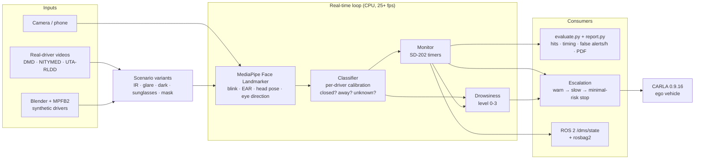
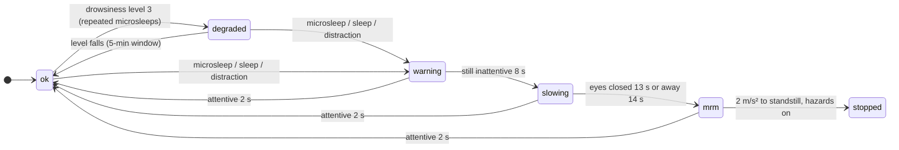
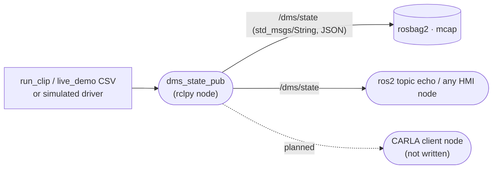

# Architecture

How the parts fit together. Scoring rules: [`METHOD.md`](METHOD.md). Results: [`EXPERIMENTS.md`](EXPERIMENTS.md).

## Data flow



## Method tiers

Production DMS work splits methods by where they can run; every tier is scored with the same evaluator.

| Tier | Runs where | Methods | Role here |
|---|---|---|---|
| 1. Real time | CPU, 25+ fps | MediaPipe blink score / EAR, head pose (MobileGaze CNN: 12-17 fps, below 25) | warnings, escalation, CARLA |
| 2. Stronger perception | GPU, ~4 ms/frame | DINOv2 / CLIP features + linear probe | does a foundation backbone help? (E4, E9) |
| 3. Offline / cloud | seconds per frame | hosted VLMs (Llama 3.2 Vision, Nemotron VL) | auto-labelling, event review (E5) |
| 4. Data generation | offline | Blender drivers, image variants, CARLA, Cosmos control videos | test cases you cannot record safely |

## Escalation (what the car does)



- `mrm` (minimal-risk manoeuvre, UN R157 style): hazards on, move one lane right if free (CARLA `BasicAgent` checks), brake at
  2 m/s² to the lane's right edge, no move-off without the driver.
- `degraded`: speed capped at 60 km/h while the drowsiness level is 3 (an assumption; Euro NCAP only asks for earlier warnings).
- In CARLA the ego is driven by `BasicAgent` along its lane; traffic uses the Traffic Manager.

## ROS 2 interface



Message: `{"t", "closed", "away", "warnings", "level"}` at the frame rate. ROS 2 Jazzy in WSL Ubuntu 24.04. CARLA's native ROS 2
is not used: a no-op in the Windows build, and Jazzy has a FastDDS mismatch ([details](details/ROS2.md)).

## Repository layout

```
driver-attention-bench/
├── src/                    core library (pure Python, each file has an assert self-check)
│   ├── signals.py          MediaPipe signals, calibration, per-frame decision, comparison arms
│   ├── dms_core.py         SD-202 timers (Monitor)
│   ├── drowsiness.py       drowsiness level 0-3 from microsleeps, long blinks, PERCLOS
│   ├── escalation.py       warn → slow → minimal-risk manoeuvre (2 m/s² ramp); speed cap at drowsiness level 3
│   ├── dino_eye.py         DINOv2 + linear probe eye-state arm (live, GPU)
│   ├── variants.py         IR look, glare, dark, sunglasses, mask
│   ├── evaluate.py         event matching, Wilson CI, false alerts/h, arm comparison
│   └── report.py           PDF test report
├── scripts/                entry points
│   ├── run_clip.py         one video / camera → per-frame CSV + warnings
│   ├── replay.py           re-run the decision step on saved signals (threshold sweeps, leave-one-driver-out)
│   ├── drowsy_eval.py      drowsiness level per clip on saved signals, vs the level the labels give
│   ├── render_overlay.py   burn decisions, truth and warnings into a video
│   ├── cues_to_labels.py   voice-cue log → labels (no detections used)
│   ├── dmd_to_labels.py    DMD OpenLABEL → events + scoring scope
│   ├── live_demo.py        DMS → drowsiness + escalation → CARLA (traffic, minimal-risk manoeuvre, --video)
│   ├── carla_fcw.py        collision-warning sweep
│   ├── carla_smoke.py      CARLA connection / GPU smoke test
│   ├── dms_safety_mc.py    DMS accuracy → crash-probability Monte Carlo
│   ├── fm_eye_probe.py     DINOv2 / CLIP probes (DMD)
│   ├── ir_eye_probe.py     infrared eye images (MRL Eye)
│   ├── vlm_arm.py          hosted vision-language models
│   ├── cosmos_transfer.py  Cosmos Transfer request (prepared; endpoint unavailable on the free tier)
│   ├── ros2/               dms_state_pub.py (rclpy), record.sh (rosbag2)
│   └── make_results.py     builds results/ from out/
├── scenarios/*.toml        test suites: clips × variants × settings
├── tools/blender/          synthetic driver renders (Blender 4.5 + MPFB2)
├── results/                published figures, GIFs, H.264 videos, summary CSVs, synthetic PDF report
├── docs/                   ARCHITECTURE, METHOD, EXPERIMENTS; details/ (theory, setup, ROS 2, synthetic, foundation models, VLMs, Cosmos)
└── run_suite.sh            suite runner (Linux / WSL)
```
