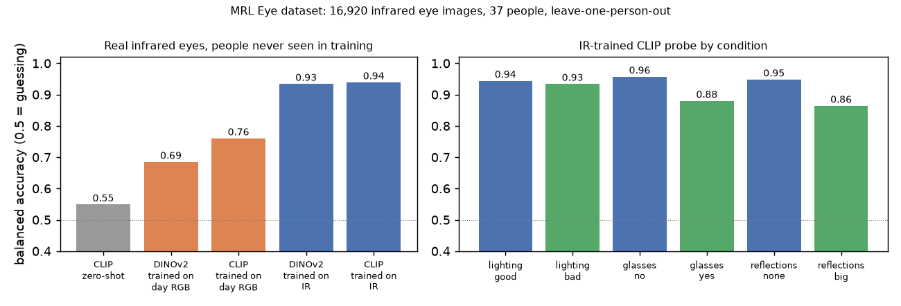
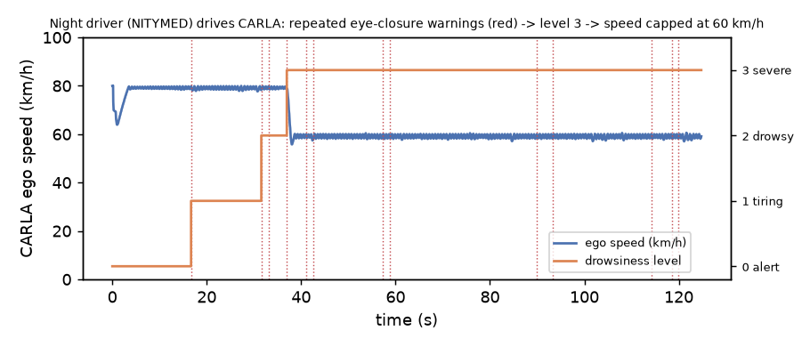

# Experiments

All results, including the ones that did not work. Numbers are small-sample: read the 95 % intervals, not the point values.
Scoring rules: `METHOD.md` section 4.

## E1. Synthetic drivers (Blender, 6 clips, exact labels)

| Run | Hits | Rate (95 % CI) | Median timing error | False alerts |
|---|---|---|---|---|
| first run | 15/18 | 0.83 (0.61-0.94) | 0.04 s | 3 |
| after the closed-eyes fix | 15/18 | 0.83 (0.61-0.94) | 0.04 s | 0 |

- The 3 misses are eye closures behind dark sunglasses: the eyes are "unknown", which is the intended behaviour (never guess closed).
- The 3 false alerts were "long distraction" while the eyes were closed: closed lids made the eye-direction cue look away.
  Fix: use head pose only when the eyes are closed or hidden.

## E2. Real drivers: DMD, from first run to the fixed measurement

Default arm (blink score), 6 drivers. Each row changes one thing.

| Step | What changed | Hits | False alerts/h |
|---|---|---|---|
| 1 | first run: 2 s calibration, every second scored | 7/66 | 107 |
| 2 | score a kind only where DMD labels it (`--scope`) | 7/62 | 18.9 |
| 3 | 20 s calibration (clips start looking away / eyes closed) | 10/58 | 9.7 |
| 4 | label convention: "closed" = lids shut (`close`), not `closing` + `close` | 22/49 | 19.4 |

- Steps 2-4 fix the **measurement**, not the detector. Most of the gain is in how ground truth is defined.
- Step 4: with `closing` counted as closed, the timer starts while the lids are still moving, so most warnings came 0.2-1 s "late".
  SD-202 times eye closure; both conventions are reported because the choice changes the result a lot.
- Even per frame the eye signals are about 97 % correct (E4), so the remaining misses are mostly timing at the ±0.2 s limit.

## E3. Comparison arms on DMD (20 s calibration, scoped)

| Arm | Labels | Hits | False alerts/h |
|---|---|---|---|
| blink score (default) | closing + close | 10/58 | 9.7 |
| EAR | closing + close | 16/58 | 24.2 |
| blink score | close only | 22/49 | 19.4 |
| EAR | close only | 30/49 | 33.9 |
| head pose + eye direction (default gaze) | gaze clips | 2/12 | 42.6 |
| MobileGaze network | gaze clips | 3/12 | 32.0 |

**Threshold tuning (`closed_frac`), chosen on the other drivers (leave-one-subject-out):**

| Arm | Labels | Default 0.5 | Tuned on other drivers |
|---|---|---|---|
| blink score | closing + close | 10/58, 9.7/h | 16/58, 33.9/h |
| EAR | closing + close | 16/58, 24.2/h | 15/58, 36.4/h |
| blink score | close only | 22/49, 19.4/h | 25/49, 29.1/h |
| EAR | close only | 30/49, 33.9/h | 29/49, 31.5/h |

Tuning one threshold mostly trades hits for false alerts; it does not transfer clearly to a new driver. The default stays 0.5.

## E4. Foundation models for eye state (DMD, per frame, leave-one-subject-out)

5,665 frames (870 closed), 6 drivers; frames in the middle of opening/closing excluded.

| Method | Balanced accuracy | F1 (closed) | Time per frame |
|---|---|---|---|
| blink score threshold | 0.968 | 0.917 | MediaPipe pass (CPU) |
| EAR threshold | 0.973 | 0.924 | same pass |
| CLIP zero-shot ("open eye" / "closed eye") | 0.698 | 0.377 | 3.5 ms (GPU) |
| CLIP features + linear classifier | 0.972 | 0.923 | 3.5 ms (GPU) |
| DINOv2-small features + linear classifier | 0.966 | 0.926 | 4.5 ms (GPU) |

Frozen foundation features match the cheap signals but do not beat them; zero-shot CLIP is weak at a fine detail like eyelids.
Details and caveats: `details/FOUNDATION.md`.

## E5. Hosted vision-language models (VLMs) on synthetic frames

Free NVIDIA build.nvidia.com API, zero-shot, 142 frames. DMD is never sent (licence). Details: `details/VLM.md`.

| Model | Eyes closed (bal. acc.) | Looking away (bal. acc.) | Seconds per frame |
|---|---|---|---|
| Llama 3.2 11B Vision | 0.59 | 0.46 | 2.7 |
| Nemotron VL 120B (reasoning) | 0.59 | 0.63 | 8.6 (29 of 142 unparseable answers) |

For comparison, the real-time pipeline scores ~0.97 per frame on eye state (E4) at ~30 ms. Zero-shot VLMs are near chance on
eyelids and about 90-290x too slow for a 25 Hz warning; their use is offline (labelling help, describing an event afterwards).
Caveat: 142 frames, synthetic faces, closures behind sunglasses count as "closed" in the labels.

Listed but not callable on the free tier (HTTP 404 "Function not found for account"): Cosmos Reason 2, Gemma 3, VILA, Phi-3 Vision.

## E6. CARLA: why driver state matters for the car

**Collision warning sweep** (`scripts/carla_fcw.py`, stationary car ahead; reaction 1.0 s attentive / 1.6 s inattentive, braking 8 m/s²):

| Speed | Attentive (warning at TTC 2.0 s) | Inattentive, fixed warning (TTC 2.0 s) | Inattentive, DMS-gated warning (TTC 3.0 s) |
|---|---|---|---|
| 30 km/h | stops | impact at 14 km/h | stops |
| 50 km/h | stops | impact at 37 km/h | stops |
| 80 km/h | impact at 45 km/h | impact at 70 km/h | impact at 15 km/h |

At 80 km/h a 2 s warning is too late even for an attentive driver: the sweep shows the limit of warning-only systems.

**Live escalation** (`scripts/live_demo.py`, simulated driver, eyes closed from 2 s): warning 3.5 s, slowing 10 s, minimal-risk stop 15 s,
standstill 23.2 s after the MRM fix in E10 (`results/live_escalation.png`). The DMS state is also published as ROS 2 topic `/dms/state` and recorded to a rosbag (`details/ROS2.md`).

## E7. Speed

| Part | Speed |
|---|---|
| default pipeline (MediaPipe, CPU) | ~35 fps Windows / ~58 fps WSL |
| MediaPipe Face Landmarker alone, WSL, CPU (XNNPACK) vs GPU delegate | CPU 86 fps; GPU via OpenGL ES → Mesa D3D12 → RTX 4050: 6.4 fps (translation layers + frame copies dwarf a tiny model); software OpenGL: fails |
| with MobileGaze | ~12-17 fps (below the 25 Hz SD-202 video rate) |
| DINOv2 / CLIP on two eye crops (GPU) | 3.5-4.5 ms per frame |
| hosted VLM | seconds per frame: offline use only |

## E8. Live phone camera (own face, voice-guided takes)

Phone (Xiaomi 14) as a Windows connected camera; `scripts/run_clip.py 0 --show --record`; a spoken guide (Windows TTS) logs
cue times. Truth is labelled by hand from the raw frames, independent of the system's output.

| Take | Arm | Result |
|---|---|---|
| 4 | DINOv2 + linear probe, live (17 ms/frame GPU, ~15 fps overall) | real closure P(closed) ≈ 0.99, microsleep + sleep on time; 1 likely false microsleep while looking ahead (P ≈ 0.5-0.65): the DMD-trained probe is unsure on a new face and camera |
| 5 | blink score (default), ~30 fps | first run: 4/4 warnings, but looking down was 0.8 s late. After the fix below: 4/4 within ±0.2 s, 0 false alerts |

**Bug found by the live take:** looking down lowers the eyelids, so a few frames read as "closed". Each such frame ended the
look-away episode and restarted the 3 s distraction timer. Fix in `dms_core.Monitor`: closed gaps of up to 0.5 s bridge a
look-away episode (a long closure stays sleep, not distraction). A first version without the 0.5 s bound created a false
distraction warning during a real eye closure; the bounded version was re-checked on all data: synthetic 15/18 with 0 false
alerts and DMD identical on every arm. The 0.5 s bound comes from one take.

## E9. Real infrared: MRL Eye (night-time proxy)

DMD no longer publishes IR video (all three DMD sets are RGB-only now), so real IR comes from the MRL Eye Dataset: 84,898 cropped
infrared eye images, 37 people, three IR sensors, labelled open/closed, lighting good/bad, glasses, reflections. Sampled 16,920
images (8,492 closed). MediaPipe blink/EAR cannot run on eye crops (they need a whole face), so this tests the eye classifiers only.

| Method | Balanced accuracy | F1 (closed) |
|---|---|---|
| CLIP zero-shot | 0.55 | 0.69 |
| DINOv2 probe trained on DMD daylight RGB -> tested on IR | 0.69 | 0.58 |
| CLIP probe trained on DMD daylight RGB -> tested on IR | 0.76 | 0.77 |
| DINOv2 probe trained on IR, tested on unseen people (LOSO) | 0.93 | 0.93 |
| CLIP probe trained on IR, tested on unseen people (LOSO) | 0.94 | 0.94 |

CLIP IR probe by condition: bad lighting 0.93 vs good 0.94; glasses 0.88 vs none 0.96; big reflections 0.86 vs none 0.95.
GPU forward pass: DINOv2-small 1.3 ms, CLIP ViT-B/32 0.7 ms per eye image.

**Reading:** a model trained on daylight RGB drops to 0.69-0.76 on infrared: the day-to-night domain gap is real. Trained on IR it
reaches 0.93-0.94 on people it never saw, and low light barely matters in IR; glasses and strong reflections are the hard cases.
This is why production DMS cameras are IR and why IR training data matters. Caveats: cropped eyes, not a car DMS camera, single
frames, subsampled. Details: `details/FOUNDATION.md`.

## E10. CARLA with real data, and from detector accuracy to crash outcomes

**Real face drives the car.** `scripts/live_demo.py data/clips/clip05_live.mp4` feeds the recorded phone take (E8) into the CARLA
escalation: warning at the eye closure and at the head turn, back to OK each time because the driver looked back within 8 s.
`live_demo.py <clip> --video out.mp4` records the face panel and a chase camera during the run (CARLA's sync sensor-queue pattern; `results/demo_face_to_carla.gif`). A first version rendered from recorder replays instead: replays end with their vehicles on autopilot, those leftovers got recorded into later runs, and the camera followed a wrong car; now every run clears leftover vehicles (`apply_batch_sync`) and no replay is needed.
Two fixes made on the way: video frames (30 fps) now all feed the DMS while the car steps at the 20 Hz sim rate (before, one sim
tick per frame ran the car 1.5x slow); the Traffic Manager is pinned to the start lane (`tm.set_path`), because a replay showed the
minimal-risk stop ending at a highway-exit gore instead of in lane. The scene now loads props, street lights, buildings and foliage on top of the ground layer (fits the 6 GB GPU, ~2.7 GB) and adds six Traffic-Manager cars in the neighbouring lanes, so the slow-down and the stop in lane are visible against traffic.

**Minimal-risk manoeuvre, done like the regulation and CARLA's own planner.** UN R157 (automated lane keeping, https://unece.org/sites/default/files/2023-12/R157e.pdf) requires the MRM to
slow the car "inside the lane" at ≤ 4 m/s², hazard lights from its start, standstill, and no move-off without manual input. On top,
as some production systems do, the car now moves to the slower lane first when that is safe: at the MRM start CARLA's reference
`BasicAgent` (LocalPlanner + PID) takes over from the Traffic Manager; each tick it checks, exactly like CARLA's `BehaviorAgent`,
that the lane marking allows a change to the right, the right lane drives the same way, and no vehicle is in it front or rear; then
it plans the change with the agent's lane-change path. In the rightmost lane it drives at the lane's right edge (planner lateral
offset) and stops there. Town04's shoulders are 0.5 m wide, too narrow to stop on. Run: lane −3 → −4, standstill at the right edge,
hazards and brake lights on, a following car stops behind it. If the lane is occupied, it simply stops in its lane (R157 baseline).
Bug fixed on the way: the escalation ramp fed the measured speed back every tick, so controller overshoot ratcheted the target
down (~5 m/s² instead of 2); it is now a time-based ramp from the speed at MRM start (self-check added), measured 2.0 m/s² in CARLA.

**Monte Carlo** (`scripts/dms_safety_mc.py`): distracted driver, stopped car ahead, kinematics and thresholds as the CARLA sweep
(warning TTC 2.0 s, or 3.0 s when the DMS flags inattention; braking 8 m/s²), reaction time lognormal with median 1.6 s (assumption),
20,000 drivers per point. The DMS catches the inattention with probability p.

| Speed | No DMS: crash / mean impact | DMS, p = 0.61 (DMD, EAR arm): crash / impact | Ideal DMS, p = 1: crash / impact |
|---|---|---|---|
| 30 km/h | 60 % / 14 km/h | 28 % / 6 km/h | 7 % / 2 km/h |
| 50 km/h | 87 % / 33 km/h | 44 % / 16 km/h | 17 % / 5 km/h |
| 80 km/h | 100 % / 65 km/h | 68 % / 38 km/h | 49 % / 20 km/h |

The kinematic model reproduces the CARLA sweep case (30 km/h, fixed warning: 14.2 km/h impact). p = 0.61 is a conservative proxy
(event-level hit rate within ±0.2 s on DMD); a distraction caught 0.5 s late would still move the warning earlier. The result is a
model, but it links the perception metric to a vehicle-level outcome, which is what a requirement for DMS accuracy needs.

## E11. Night-time driving (NITYMED) and a calibration fix

NITYMED: 19 videos of drivers at night in real moving cars, dash camera, 25 fps, CC BY 4.0 (Petrellis et al.). The face was found
in 97-100 % of frames, but watching the overlays showed eyes reported "open" while clearly shut. Two causes, measured:
1. In low light the blink score rarely passes 0.8 for a closed eye (peaks ~0.6-0.8), close to the closed threshold.
2. The per-driver baseline was the median of the first seconds. In 3 of 19 videos the driver blinked or looked down then, the
   "open" blink level came out as 0.31-0.56 instead of ~0.1, and the closed threshold rose to 0.78: closures were never "closed".

Fix: **robust calibration**. "Eyes open" = the most-open 20 % of the calibration window (blink 20th / EAR 80th percentile), capped at
plausible open values. Truth: two night videos hand-labelled at 0.5 s steps without the system's output (25 microsleeps, 27
expected warnings). Hand labels are ±0.3 s, so a hit here = warning between the required moment -0.5 s and the event end +0.5 s.

| Method | Night: hits / false alerts (count) | DMD (lids shut, ±0.2 s) | Synthetic | Own take 5 |
|---|---|---|---|---|
| Blink, median calibration (old default) | 7/27, 0 | 22/49, 8 | 15/18, 0 | 4/4, 0 |
| Blink, robust calibration (new default) | 10/27, 0 | 22/49, 8 | 15/18, 0 | 4/4, 0 |
| Blink, one fixed threshold 0.4 | 15/27, 2 | 30/49, 20 | 15/18, 0 | 3/4, 2 |
| EAR, median calibration | 10/27, 0 | 30/49, 14 | 15/18, 0 | 3/4, 2 |
| **EAR, robust calibration** | **16/27, 1** | 31/49, 17 | 15/18, 0 | 3/4, 2 |

Reading: robust calibration costs nothing on any other dataset and helps at night, so it is now the default. A well-chosen fixed
threshold is a real alternative: EAR fixed at 0.15 gives 31/49 on DMD (17 false alerts) vs 30/49 (14) calibrated, and the
leave-one-driver-out choice still prefers calibration for its fewer false alerts; a fixed blink threshold helps at night but adds
false alerts in daylight and on the phone take. No single eye signal wins everywhere: EAR is better on DMD and at night, the blink score on the daytime phone
take. Default stays blink score; EAR (`--eye ear`) is the recommended setting for night and real-car footage.

**Same flaw, gaze side** (found by watching the night overlay): the clip showed "looking away" whenever the driver's eyes were open.
Drooping lids raise MediaPipe's eyeLookDown scores, so a drowsy calibration window learned "looking down" as "ahead" (eye_v baseline
−0.68 vs −0.12 when alert); every alert frame then deviated by 0.63 > 0.35 and read as away. Fix: the robust calibration takes the
head and eye-direction baseline only from calibration frames whose eyes are open. On that clip all false distraction warnings
disappeared (only microsleep/sleep remain); re-checked on all labelled data with no change (take 5: 4/4; synthetic: 15/18;
DMD: identical on every arm, including the gaze clips).

## E12. Drowsiness level: from repeated microsleeps to a degraded mode

**Question.** The warnings so far react to one closure at a time. A driver who keeps having microsleeps is drowsy, and a car could
do more than beep. What do regulations and car makers actually do? Sources checked (primary where marked):
- **Euro NCAP Safe Driving, Driver Engagement protocol** (v11, read from the PDF): drowsiness must be detected at KSS > 7 at the
  latest; the vehicle response for drowsiness, microsleep and sleep is a warning (rest-area advice allowed for drowsiness) plus an
  **intervention = more sensitive Forward Support** (collision warning / AEB at least 200 ms earlier for an impaired driver) with
  Lane Support; it may not be reset by the driver. Slowing down is **not** scored for drowsiness. "Assisted Mode" is eligible for
  sleep. A driver is **unresponsive** when the eyes stay closed ≥ 6 s or the gaze does not return within 3 s of a distraction
  warning; the Emergency Function then starts by 12-13 s. Our existing MRM at 13 s closed / 14 s away matches that timeline.
- **EU DDAW** (Reg. 2021/1341): warning at KSS ≥ 8; **ADDW** (Reg. 2023/2590): distraction warning. Warnings only.
- Production: VW Emergency Assist, Volvo EX90 and Ford BlueCruise slow / stop the car for an **unresponsive** driver; Mercedes and
  BMW details only from secondary sources [verify]. No production system found that slows a merely drowsy driver [verify].

**Design** (`src/drowsiness.py`, beside the unchanged SD-202 `Monitor`). A KSS-like level from three cues, each over a window:
microsleep warnings in the last 5 min, long blinks (closed ≥ 0.5 s) in the last minute, PERCLOS over 60 s (used only once its
window is full: right after calibration it is one blink over a few seconds and read 0.6). Any one cue reaches a level:

| Level | Meaning | Cue (any one) | Car response here |
|---|---|---|---|
| 0 | alert | | none |
| 1 | tiring (KSS ~7) | PERCLOS ≥ 0.08, 1 microsleep, or 6 long blinks / min | rest advice |
| 2 | drowsy (KSS ≥ 8) | PERCLOS ≥ 0.15 or 2 microsleeps / 5 min | urgent warning + collision warning at TTC 3.0 s instead of 2.0 s (the E6 "DMS-gated" column) |
| 3 | severe | PERCLOS ≥ 0.30 or 3 microsleeps / 5 min (two drowsiness warnings ignored) | degraded mode: speed capped at 60 km/h (our assumption, not a regulation) |

Unresponsive driver → MRM is unchanged and still needs the 13 s / 14 s timers; level 3 never replaces it. PERCLOS 0.15 is the
common P80 cut-off; all other thresholds are guesses and would be tuned on progressive data (see Data below).

**Bug found on the way: looking down counted as drowsiness.** On DMD every microsleep warning in the alert gaze sessions (s6) fired
while the head was out of the forward cone (blink 4/4, EAR 24/24); in the drowsiness sessions (s5) almost none did (1/26, 2/40).
Looking down lowers the lids. Fix: closures with the head away do not count towards the level (the SD-202 warnings are untouched).
Cost: a driver whose head drops during a microsleep is counted later (NITYMED P1042793 below), the sleep warning and MRM still apply.

**Results** (offline replay of the saved signals, `scripts/drowsy_eval.py`; "label level" = the same code run on the hand / dataset
closure labels, so it measures the detector, not the thresholds):

| Data | Blink score (default) | EAR |
|---|---|---|
| DMD alert gaze sessions (s6, 6 clips): level ≥ 2 without / with the head-away fix | 1/6 → **0/6** | 4/6 → **1/6** |
| DMD drowsiness sessions (s5, 7 clips): highest level = label level | 5/7 (2 one or two levels low) | 6/7 (1 one level high) |
| DMD s5, level 3 reached where the labels reach it (5 clips) | 3/5, all within 0.3 s, never early | 5/5, but 4 of them 8-49 s early |
| NITYMED, 19 night drivers (all from the microsleep set): highest level 0/1/2/3 | 9 / 5 / 1 / 4 | 5 / 5 / 1 / 8 |
| NITYMED hand-labelled P1043067 | all levels within 0.2 s of label level | same |
| NITYMED hand-labelled P1042793 | level 2 at 54 s (label: 3 at 37 s) | level 3, 6-17 s late (first closures with head turned) |
| Synthetic (6 clips) | 5/6 = label level within 0.1 s; sunglasses clip stays 0 (eyes unknown by design) | same |
| Own phone take 5 | level 1 at 25.4 s = label level | same |
| UTA-RLDD subject 08, "alert" video (9.75 min, natural, self-rated) | level 0 throughout, 0 microsleeps | level 0, peak PERCLOS 0.006 |

**CARLA closed loop** (`scripts/live_demo.py <clip> --eye ear`, HMI shows the level):

| Driver | Eye-closure warnings | Level 3 → 60 km/h cap | Offline replay |
|---|---|---|---|
| NITYMED P1043089 (night, CC BY 4.0) | 16.7 s, 31.6 s, … | 37.0 s | 37.0 s |
| NITYMED P1042793 | 13.7 s, 22.2 s, … | 54.3 s | 54.2 s |
| DMD gB_10 s5 (local only, never published) | 65.3 s, … | 106.2 s | 106.2 s |
| Simulated sleeping driver (regression) | 3.5 s → slowing 10 s → MRM 15 s → standstill 23.1 s | – | E6: 23.2 s |

**Bug fixed in the CARLA demo.** A night run showed the ego slowing to 16 km/h around 30 s with nobody asleep. The recorder and a
debug print traced it: approaching a highway junction ~700 m ahead, the Traffic Manager applied a 30 km/h junction limit to the ego
despite `set_desired_speed`, ignoring signs, lights and vehicles (also in the previously published night run). The ego now drives
with CARLA's `BasicAgent` along its lane with speed limits off (as the MRM already did); this also removed the TM speed-trim hack.
It holds 78-80 km/h over 130 s; the escalation timeline is unchanged.

**Regression.** SD-202 timers and the per-frame classifier are untouched; re-run: DMD lids-shut 22/49 (8 false alerts) blink,
31/49 (17) EAR; synthetic 15/18, 0; night hand-labelled 10/27, 0 and 16/27, 1 (5 s calibration); take 5 4/4, 0. All identical to E1-E11.

**Data for progressive drowsiness.** DMD and NITYMED are acted microsleeps over 2-3 min, so the 5-min window is never stressed.
Free options checked: **UTA-RLDD** (60 people, ~10 min each in self-rated alert / low-vigilant / drowsy states, natural, RGB, Google
Drive; licence not stated [verify]: never published here). Its Drive quota blocked the download after one video; the alert video is
in the table, the drowsy pair is pending. **UL-DD** (19 drivers, 40 min continuous, KSS every 4 min, 2025) needs a request with an
institutional e-mail and a data-use agreement. **DROZY** (IR, sleep deprivation, PSG) and **NTHU-DDD** (acted, licence form) are
the alternatives. The thresholds above need one of these to be tuned honestly.

**Limits.** Small and short clips; the levels are KSS-like, not validated against KSS; the head-away rule trades missed nodding-off
closures for fewer false levels; the 60 km/h cap is our assumption; no lead car in the scene, so the earlier collision warning at
level 2 is shown by the E6 sweep, not in this run.

## Considered, not done

| Idea | Why not |
|---|---|
| NVIDIA Cosmos Transfer (photoreal video from CARLA) | needs 65-80 GB GPU; hosted endpoint returns 404 on the free tier. Control videos are prepared (`details/COSMOS.md`). |
| SAM 3 / Grounding DINO in the live loop | gives masks / boxes, not eyelid state, and too slow on 6 GB. Fits occupant monitoring (phone, child seat) or offline labelling. |
| Small temporal model (GRU) on per-frame signals | per-frame accuracy is already ~97 %; the misses come from label timing, which a model trained on the same labels would copy. |
| Paid cloud GPUs | project rule: free tier only. Kaggle / Colab free T4 would work for bigger models, but DMD must not be uploaded. |
| More own recordings | 2 voice-guided phone takes are in E8; a larger own set (more people, an IR camera) is future work. |
